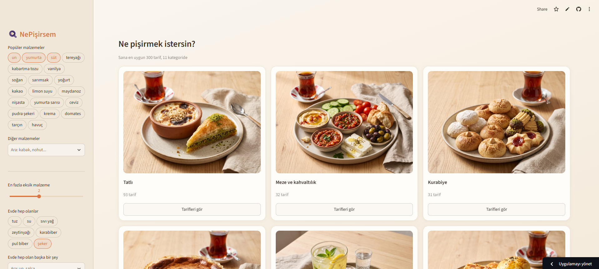
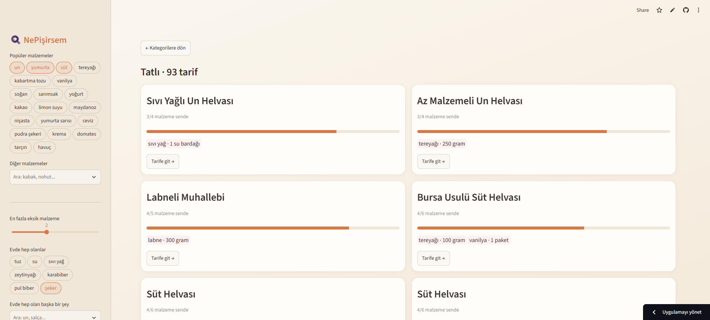
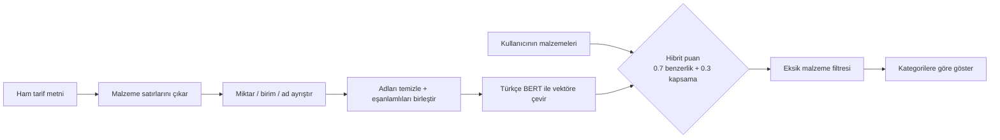

# 🍳 NePişirsem

**Elindeki malzemeleri seç, 14.691 Türkçe tarif arasından yapabileceklerini bul.**
Uygulama her tarif için hangi malzemelerin eksik olduğunu ve ne kadar gerektiğini de gösteriyor.

🔗 **Canlı demo:** [nepisirsem.streamlit.app](https://nepisirsem.streamlit.app/)
<sub>Ücretsiz sunucuda çalıştığı için uygulama bir süre ziyaret edilmezse uykuya geçer; açılması bir dakika kadar sürebilir.</sub>




## Neden bu projeyi yaptım?

Bitirme projemin veri setini beklerken boş durmak yerine baştan sona kendim geliştirebileceğim bir proje yapmak istedim. Fikir çok gündelik bir sorudan çıktı: “Evde şunlar var, ne pişirsem?” Amacım sadece çalışan bir uygulama yapmak değil, bir yapay zekâ projesinin bütün sürecini öğrenmekti: ham veriyi temizlemek, bir dil modeliyle arama yapmak, sonuçları ölçmek ve canlıya almak. En çok şaşırdığım şey, en büyük iyileştirmelerin modelden değil veriden gelmesi oldu. Malzeme adlarındaki küçük yazım sorunlarını düzeltmek, bir tarifin bulunma ihtimalini modeli değiştirmekten daha çok artırdı.

## Nasıl çalışıyor?



1. **Veri hazırlama:** Tarif metinlerinden malzeme satırları çıkarılıyor, miktar ve birim ayrıştırılıyor (`"2 su bardağı un"` → `un`, `2 su bardağı`), adlar temizlenip eşanlamlılar tek bir ada indiriliyor (`tereyağ` → `tereyağı`).
2. **Anlamsal benzerlik:** Her tarifin malzeme listesi, Türkçe için eğitilmiş bir cümle modeliyle ([`emrecan/bert-base-turkish-cased-mean-nli-stsb-tr`](https://huggingface.co/emrecan/bert-base-turkish-cased-mean-nli-stsb-tr)) 768 boyutlu bir vektöre çevriliyor.
3. **Kapsama:** Tarifin malzemelerinin ne kadarının kullanıcıda olduğu hesaplanıyor. Kullanıcının "evde hep var" dediği malzemeler (tuz, su...) de hesaba katılıyor.
4. **Hibrit sıralama:** İki puan `0.7 × benzerlik + 0.3 × kapsama` olarak birleştiriliyor. Ağırlık aşağıdaki değerlendirmeyle seçildi.

## Değerlendirme: hangi sıralama yöntemi daha iyi?

Elle etiketlenmiş bir veri olmadığı için **"kaynak tarifi geri bulma"** testi kullandım: rastgele bir tarif seçilip malzemelerinin %60'ı "kullanıcının elindekiler" yapılıyor. İyi bir yöntem o tarifi üst sıralarda göstermeli. Doğru cevap sorguyu üretirken zaten bilindiği için etiketlemeye gerek kalmıyor.

Ağırlık 200 sorguluk bir doğrulama setinde (`seed=42`) seçildi, aşağıdaki sonuçlar ise **hiç görülmemiş** 200 sorguluk bir test setinden (`seed=7`):

| Yöntem | Kaynak tarif 1. sırada | İlk 10'da | MRR | İlk 10'da ort. eksik malzeme |
|---|---|---|---|---|
| Kapsama (basit sayma, baseline) | %0 | %15,0 | 0,05 | **0,74** |
| Anlamsal benzerlik (BERT) | %35,0 | %68,5 | 0,47 | 4,19 |
| **Hibrit 0.7 / 0.3 (kullanılan)** | **%46,5** | **%75,5** | **0,56** | 2,64 |

- Basit sayma, az malzemeli küçük tarifleri hep üste taşıdığı için aranan tarifi neredeyse hiç bulamıyor, ama önerdikleri hemen yapılabiliyor.
- BERT aranan tarifi çok daha iyi buluyor, ama önerdiği tarifler ortalama 4 eksikle geliyor.
- Hibrit puan, şu anki yöntemi **her metrikte** geçiyor: aranan tarifi daha iyi bulurken eksik sayısını 4,2'den 2,6'ya indiriyor.

Tekrar üretmek için: `python -m scripts.evaluate --n 200 --seed 7`

## Veriye bakarak verilen kararlar

| Bulgu | Karar | Etki |
|---|---|---|
| Veride `"1orta boysoğan"` gibi yapışık yazımlar | Boy sıfatlarını boşluksuz da temizle | "soğan" eşleşen tarif: 1.424 → 2.493 (**+%75**) |
| Aynı malzemenin farklı adları (`tereyağ` / `tereyağı`) | Eşanlamlı sözlüğü | 6.051 tarifin malzeme listesi düzeldi |
| Noktasız `"gr"` birimi veride hiç geçmiyor | Bu durum için kod yazılmadı (YAGNI) | Koruma testiyle kilitlendi |
| "Diğer" kategorisinde tekrarlayan kelimeler | 30 yeni kategori kelimesi | "Diğer" oranı: %20,1 → %14,5 |
| Arayüz "tuz, su, yağ" diyordu ama kod şekeri de var sayıyordu | Temel malzemeleri kullanıcı seçiyor | Sahte "hemen yapabilirsin" sonuçları kalktı |

Bu analizlerin kodları [`experiments/`](experiments/) klasöründe.

## Kurulum

Python 3.13 ile geliştirildi (canlı sunucuda 3.14 ile çalışıyor).

```bash
git clone https://github.com/Fahriyeelifdikci/NePisirsem.git
cd NePisirsem
py -3.13 -m venv .venv            # Windows (macOS/Linux: python3 -m venv .venv)
.venv\Scripts\activate            # Windows (macOS/Linux: source .venv/bin/activate)
pip install -r requirements.txt
streamlit run app.py
```

İlk açılışta dil modeli (~440 MB) Hugging Face'ten indirilir.

### Geliştirme

```bash
pip install -r requirements-dev.txt
pytest                              # 100+ test, model yüklemeden ~1-2 saniyede çalışır
python -m scripts.build_dataset     # veriyi sıfırdan üret
python -m scripts.build_embeddings  # tarif vektörlerini yeniden hesapla (~7 dk)
```

## Proje yapısı

```
├── app.py               # Streamlit arayüzü
├── nepisirsem/          # Ayrıştırma, eşanlamlılar, eşleştirme, kategoriler, arama, değerlendirme
├── scripts/             # Veri üretimi, vektör üretimi, değerlendirme
├── tests/               # Birim testleri + veri sözleşmesi testleri
├── experiments/         # Kararlara yol açan veri analizleri
├── data/                # Hazır veri (parquet + float16 vektörler, ~22 MB)
└── assets/              # Kategori görselleri ve stil
```

## Bilinen sınırlamalar

- Malzeme eşleştirmesi kurallara dayalı. Türkçe ekleri otomatik çözmüyor (`limon suyu` → `su` gibi hatalar yaratacağı için bilerek yapılmadı), bilinen tür ilişkileri (`peynir` ↔ `kaşar peyniri`) açık bir listeyle tanımlanıyor.
- `"tereyağı veya margarin"` gibi alternatifli malzemelerde sadece ilk seçenek dikkate alınıyor.
- Kategoriler başlık ve malzeme kurallarıyla belirleniyor. Tariflerin yaklaşık %14,5'i hâlâ "Diğer"de.
- Değerlendirme gerçek kullanıcı etiketleri yerine otomatik üretilen sorgularla yapıldı. Sıralamanın kullanıcıya ne kadar "iyi" geldiğini tam olarak ölçmüyor.
- Farklı dil modelleri büyük ölçekli değerlendirmeyle karşılaştırılmadı. Model seçimi küçük bir benzerlik testiyle yapıldı.

## Gelecekte yapılabilecekler

- "Evde ne var" listesinin hatırlanması (kullanıcı hesabı / tarayıcı hafızası)
- Farklı dil modellerinin değerlendirme sistemiyle karşılaştırılması
- Küçük, elle etiketlenmiş bir değerlendirme seti
- "X veya Y" malzemelerinde "ikisinden biri yeter" mantığı
- Etsiz köfteler (mercimek, fellah...) için ayrı bir kategori

## Veri kaynağı ve lisans

Tarifler Hugging Face'teki [`habanoz/yemek_tarif_24k_text`](https://huggingface.co/datasets/habanoz/yemek_tarif_24k_text) veri setinden alındı. Tariflerin asıl kaynağı [yemek.com](https://yemek.com). Repoda tarif **metinleri bulunmuyor**, sadece başlık, bağlantı ve malzeme bilgileri var. Kullanıcı tarifin tamamı için orijinal sayfaya yönlendiriliyor.

Kod [MIT lisansı](LICENSE) ile paylaşılıyor. Lisans **yalnızca kodu** kapsar, tarif verisinin hakları asıl sahiplerine aittir.